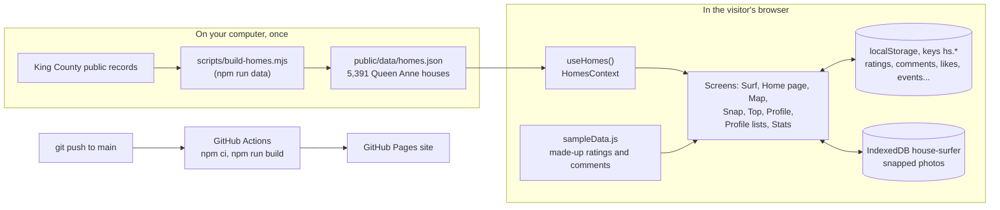

# House Surfer: architecture

For an engineer (or an AI assistant) who has never seen the project. Plain English first, details in tables. Last checked against the code: Nov 23, 2026.

**What it is:** a mobile-first web app where you swipe through houses, give 1 to 5 stars and leave short comments. It is a portfolio **demo** with **no backend**: everything a visitor does is saved in their own browser.
**Stack:** Vite + React 19 (plain JavaScript, no TypeScript), `react-router-dom` with `HashRouter`, Leaflet (`react-leaflet`) with OpenStreetMap tiles, one hand-written stylesheet. Tests use Node's built-in runner. It deploys to GitHub Pages on every push to `main`.

## The big picture

If the picture does not show, your viewer does not render Mermaid. GitHub does (open this file on github.com).

## How data flows

1. **County records to `homes.json`.** `scripts/build-homes.mjs` downloads free King County Assessor files, parcel outlines and Seattle's Queen Anne boundary into `data/raw/` (git-ignored). It keeps houses of 1 to 3 units, reduces each address to a block, **fuzzes each pin 25 to 50 m**, hashes the id, and drops owner names and sale prices. The output `public/data/homes.json` **is committed**, so a normal checkout needs no download. Re-run with `npm run data` (add `-- --refresh` to re-download).
2. **`homes.json` to the screens.** `HomesProvider` (`src/lib/HomesContext.jsx`) fetches it once. Screens call **`useHomes()`**, never `fetch` it themselves. This is also the **one place** the `showTownhouses` flag (`src/config.js`) is applied.
3. **Sample "other people".** `src/lib/sampleData.js` makes up ratings, comments and likes from the home id. Same home, same samples. They are never saved and cannot be edited.
4. **Your actions go to the browser.** Ratings, comments, likes, profile, theme, guide progress and the event log are saved in `localStorage` (all keys start with `hs.`, through `src/lib/storage.js` and `useStoredState`). Snapped photos are saved in IndexedDB (`src/lib/photoDb.js`) because they are too big for `localStorage`.
5. **Things that are computed, never stored:** a home's average and pin kind (`src/lib/homeStats.js`), like counts, karma, "hot", "home of the week", the Top lists, and the stats page numbers.
6. **Reset demo** (`src/lib/demo.js`) deletes every `hs.` key and the IndexedDB database, then reloads.

## Folders and key files

| Path | What it does |
| --- | --- |
| `src/main.jsx` | Starts the app and nests the context providers (theme, profile, homes, photos, ratings, comments, guide) inside `HashRouter` |
| `src/App.jsx` | The app frame (demo banner, app bar with the logo link, tab bar, skip link) and the routes |
| `src/config.js` | Feature flags (only `showTownhouses`) |
| `src/styles.css` | All styling. Color, radius, type and spacing **tokens** at the top; light and dark mode |
| `src/screens/` | One file per screen: `Signup`, `Surf`, `HomePage`, `MapScreen`, `Snap`, `Top`, `Profile`, `ProfileList` (the "See all" pages), `Credits`, `DrawingGallery` (hidden, `#/drawings`), `Stats` |
| `src/components/` | Shared pieces: `HouseArt` (drawings), `HomeCover` (photo or drawing, with the sample label), `Badge`, `BadgeToast`, `Avatar`, `DemoMenu`, `StarRating`, `TabBar`, `Logo`, `TryThisGuide`, `MoodImage`, `Icons`, `ProfileRows` (comment and activity rows) |
| `src/lib/` | Everything that is not a screen. React contexts (`*Context.jsx`) hold saved state; plain `.js` files are pure logic and are the ones with tests |
| `scripts/build-homes.mjs` | The county data pipeline |
| `public/` | Served as-is: `data/homes.json`, `images/mood/` (3 stock photos), `images/sample/` (20 sample house photos used as covers), `images/homes/` (your own sample covers, see `docs/STATUS.md`), `favicon.svg` |
| `tests/` | `node --test` files, one per area (see the feature table) |
| `docs/` | `01-prd.md` product requirements, `02-user-stories.md` acceptance criteria, `DECISIONS.md` why, `STATUS.md` where we are, this file, `CONTRIBUTING.md` |
| `design/` | The original clickable prototype and mockups (reference only) |
| `.github/workflows/deploy.yml` | Builds with Node 22 and publishes to GitHub Pages |

## Where each feature lives

| Feature | Screen or component | Logic in `src/lib/` | Tests |
| --- | --- | --- | --- |
| **Surf** (feed, rate, skip) | `Surf.jsx`, `StarRating`, `TryThisGuide` | `feedSession.js` (shuffled queue and your place, shared with "Next house"), `GuideContext.jsx` | `feed` |
| **Home page and comments** | `HomePage.jsx` (threads, composer, "Next house", "Saved" bar) | `CommentsContext.jsx`, `RatingsContext.jsx`, `sampleData.js` | `moderation` |
| **Moderation** (block comments about people) | the composer in `HomePage.jsx` | `moderation.js`, word lists in `moderation-words.js` | `moderation` |
| **Map and list** | `MapScreen.jsx` | `homeStats.js`, `rules.js` (gold, hot, week thresholds), `pins.js` (pin shapes, the filter chips and which homes pass them) | `a11y`, `top` |
| **Snap a house** | `Snap.jsx` | `imageTools.js` (shrink and strip GPS), `nearest.js`, `photoDb.js`, `PhotosContext.jsx` | `snap` |
| **Top** | `Top.jsx` | `top.js` (same rules as the map) | `top` |
| **Profile** (comments, activity, badges, settings, credits, Reset demo) | `Profile.jsx` (latest 5 of each list), `ProfileList.jsx` (routes `/profile/comments` and `/profile/activity`: everything, grouped by day, 20 at a time) | `profileLists.js` (incl. `groupByDate`), `demo.js`, `credits.js` (mood and sample photo credits), `houseGeometry.js` (roofs, door spans, fence gaps), `stockCovers.js` (which homes get a sample photo; the cover order) | `profile`, `credits` |
| **Events and `/stats`** | `Stats.jsx` (link from Profile) | `events.js` (log), `stats.js` (counts, north-star) | `events`, `stats` |
| **House drawings** | `HouseArt.jsx` | `houseDesign.js` (palettes, variants) | `housedesign` |
| **Accessibility and look** | tokens in `styles.css` | `a11y.js`, `contrast.js` | `a11y`, `contrast`, `style` |

## The data contract (keep these shapes)

**`public/data/homes.json`**: an array of homes.

| Field | Meaning |
| --- | --- |
| `id` | 8-character hash string, not the county parcel number |
| `address` | Block level only, like `"2400 block of Warren Ave N"` |
| `lat`, `lng` | **Fuzzed** 25 to 50 m. The exact point is never saved |
| `beds`, `baths`, `sqft`, `yearBuilt`, `lastSaleYear` | Numbers; any of `beds`, `baths`, `yearBuilt`, `lastSaleYear` can be `null`. No sale prices |
| `type` | `"Single-family"`, `"Duplex"`, `"Triplex"` or `"Townhouse"` (hidden unless `showTownhouses`) |
| `units` | 1, 2 or 3 |
| `style` | An era from year built: `"Victorian era"`, `"Craftsman era"`, `"Pre-war"`, `"Mid-century"`, `"Late century"`, `"Modern"` |
| `walk` | Walkability, whole number 0 to 100, from OpenStreetMap places within 800 m (formula in DECISIONS.md). Never called "Walk Score" |
| `places` | `{ grocery, food, transit, parks, schools }`: counts within 800 m, the inputs to `walk`. No place coordinates are saved |
| `hill` | `true` only on steep homes (ground slopes 18% or more around the home). Missing means not steep. No heights are saved |

There are no owner or resident names anywhere, ever. `walk`, `places` and `hill` are worked out from the **exact** point inside the data script only; the exact point is never saved. Code: `scripts/walkability.mjs` (OpenStreetMap via one Overpass request), `scripts/elevation.mjs` (free AWS elevation tiles), `src/lib/walk.js` (label and chips). Raw downloads are cached in `data/raw` (gitignored).

**Saved in `localStorage`** (all keys start with `hs.`; columns are `snake_case` on purpose so they can move to a database later):

| Key | Shape |
| --- | --- |
| `hs.profile` | `{ handle, joined }` (an anonymous generated handle) |
| `hs.ratings` | `{ [homeId]: { stars: 1-5, at: ISO date } }` (re-rating replaces) |
| `hs.comments` | `[{ id, home_id, parent_id \| null, user, body, created_at, edited_at \| null, deleted_at \| null }]` (replies are one level deep; delete sets `deleted_at`) |
| `hs.comment_edits` | `[{ comment_id, old_body, edited_at }]` |
| `hs.likes` | `[{ comment_id, user, created_at }]` (one per user per comment) |
| `hs.events` | `[{ name, at, handle, ...fields }]`, newest 2,000 kept. Never holds comment text, photos or location |
| `hs.theme` | `"system"`, `"light"` or `"dark"` |
| `hs.guide` | `{ dismissed, done: { rate3, comment, moderation, map } }` |
| `hs.map_pins` | Which map filter chips are on: an array of `unrated`, `low`, `mid`, `high`, `hot`, `week`. **Default (nothing saved) is `high`, `hot`, `week`** (770 homes) plus any home you rated; "All" turns all six on. Filters both the map and the List |
| `hs.avatar` | One avatar id (`teal`, `green`, `blue`, `purple`, `coral`, `amber`, `pink`, `slate`); anything else means `teal`. Cleared by Reset demo |

**Event names and their extra fields:** `app_opened {device}`, `home_viewed {home_id, source}` (source is one of feed, map, search, top, snap, other), `rating_submitted {home_id, stars, is_edit}`, `comment_posted {home_id, is_reply}`, `comment_edited {home_id}`, `comment_deleted {comment_id}`, `like_given {comment_id}`, `photo_uploaded {home_id}`, `comment_blocked {reason}`, `theme_changed {theme}`, `badge_earned {badge}` (the badge's name only).

**Badge rules** (`src/lib/badgeRules.js`, nothing saved: worked out from ratings, comments and Snap photos each time): First Steps = 5 rated homes; Block Walker = 25 rated homes; Good Neighbor Voice = 10 comments (mine, not deleted, replies count); Curb Photographer = photos of 5 different homes. Crowd Favorite and Surfer Elite need other surfers (V2) and never unlock in the demo. The first time one unlocks, `BadgeToast` logs `badge_earned` and shows "Badge earned: name"; "first time" is read from the event log, so Reset demo (which clears the log) lets it fire again.

**IndexedDB:** database `house-surfer` (version 1), store `photos`, rows `{ id, home_id, blob, created_at }`, index on `home_id`.

**Sample cover photos you add yourself:** `public/images/homes/covers.json`, `{ "<homeId>": { "file": "<name>.jpg" } }` (starts empty).

## Design kit

For prototypes, mockups and case-study visuals, start from `design/ui-kit/` (use `theme-surfer`). The app has its own styles in `src/styles.css`; don't mix them. Chips and buttons in the app must stay 44 px. The kit has tokens, components, a gallery and a README. Nothing in `src/` imports it, and Vite never bundles `design/` (it only follows imports from `index.html`; `public/` is the only folder copied as is).

## Rebuilding it elsewhere

If you need this app on another stack (Next.js, native, anything):

1. **The spec is the acceptance criteria plus the tests.** `docs/02-user-stories.md` has numbered Given/When/Then criteria for every screen (for example 3.2, 5.4). The `tests/` folder holds the rules as runnable examples: moderation, the Top rules, the feed order, the stats maths, the event log. `docs/01-prd.md` explains why.
2. **Keep the data shapes above exactly.** Same `homes.json`, same `hs.*` keys (or tables with the same columns), same event names. Then the data pipeline, the sample data and the stats page carry over unchanged.
3. **Port the pure logic first.** The plain `.js` files in `src/lib/` (moderation, `homeStats`, `top`, `stats`, `feedSession`, `nearest`, `houseDesign`) have no React in them, so they move as they are, and their tests move with them.
4. **Rebuild screen by screen,** in the order of the user stories (demo framing, guide, moderation, Snap, Top, Profile, stats), checking each criterion at about 390 px wide and 1280 px wide, in light and dark mode. Stop when every criterion passes.
5. **Keep the product rules** (see `CONTRIBUTING.md`): talk about the house, block-level addresses, anonymous handles, free public data only, houses only.

## Things that surprise people

- **No backend.** "Other people" are made up (`sampleData.js`). Two visitors never see each other.
- **`HashRouter`** (URLs look like `/#/map`) because GitHub Pages cannot rewrite paths. Vite's `base` is `/house-surfer/` and must match the repo name.
- **The map is drawn on a canvas,** with custom pin shapes. Read the comments in `MapScreen.jsx` before changing it.
- **The feed order lives outside React** (`feedSession.js`) so the Surf screen and the home page share one "next house".
- **Likes received stay 0** in single-player (you cannot like your own comment). It becomes real with shared data.
