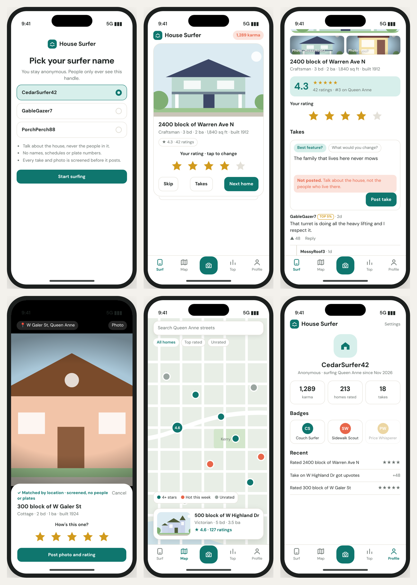
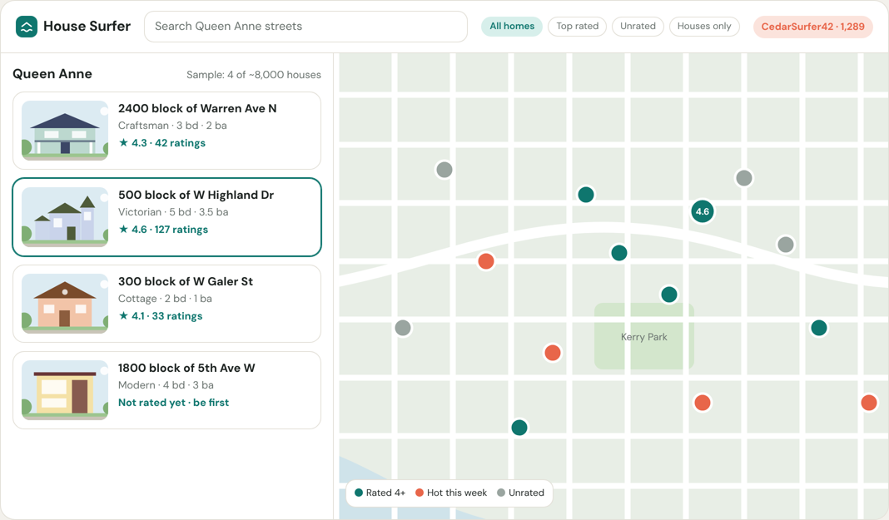
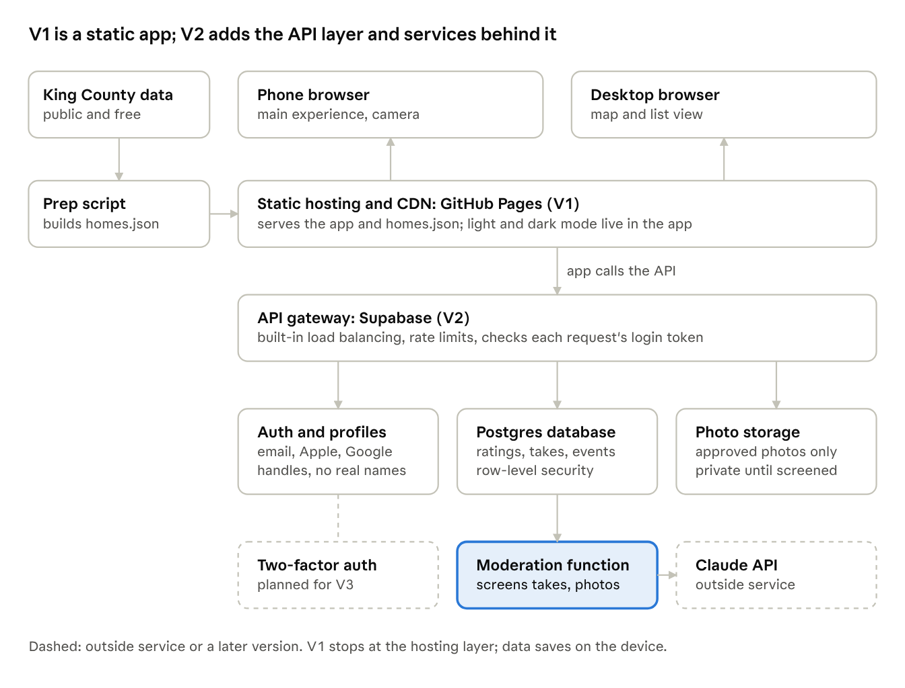

# House Surfer PRD

Nov 15, 2026 · Ryan Kelsey

## Overview

**House Surfer** is a mobile-first social app for rating houses: you swipe through homes in your neighborhood, give them 1 to 5 stars, and leave short comments that others like and reply to. Think Yelp-style ratings with Reddit-style threads, but for houses. In the case study it's pitched as **Zillow Surfer**, a concept for turning casual listing browsers into a community.

|  |  |
| --- | --- |
| **Who it's for** | People who browse homes for fun, on the couch or on a walk with friends |
| **Core loop** | See a house, rate it, read or add a comment, earn karma, come back |
| **V1 scope** | Queen Anne, Seattle; about 8,000 houses from King County public records |
| **V1 audience** | Ryan, then up to 10 invited friends |
| **One rule** | Talk about the house, never the people who live there |
| **Headline metric** | Ratings per active user per week |
| **Status** | Concept, clickable prototype and demo video done; working build next |

### Problem and opportunity

People love looking at houses, but home sites only give them something to do when they're buying or renting. Casual browsing is huge ("Zillow surfing" is a hobby), yet it's a solo, passive scroll. The fun part, reacting to homes, happens off-platform in group chats and meme accounts that share listing links.

**The opportunity:** give that energy a home. A light game layer (rate, react, earn points) turns a one-time visit into a habit, and it keeps people engaged between moves. For a listings company, that means:

- Users who are already active on the platform when they're ready to buy or rent.
- Local comments and photos that no competitor has.
- Early signal about which homes and blocks draw interest.

### Goals and non-goals

**Goals for V1 (proof of concept)**

1. Prove the core loop is fun: users rate several homes per session and come back within a week.
2. Show that a social layer on homes can stay friendly, with comments kept about the house.
3. Ship a working, mobile-first app on real public data that works in light and dark mode.
4. Produce a portfolio-ready case study with a live link, a repo and a demo video.

**Non-goals**

- Not a live public product. It's a portfolio POC for Ryan and up to 10 friends.
- No buying, selling, prices or agent leads.
- No comments about residents, owners or tenants, ever.
- No video, direct messages or follower feeds.
- No condos or apartment buildings in the first version.

## Success metrics

**North star: ratings per active user per week.** It captures the core loop directly: people coming back and rating houses.

| Type | Metric | Definition | POC target (10 friends, 4 weeks) |
| --- | --- | --- | --- |
| North star | Ratings per active user per week | Ratings divided by weekly active users | 20+ |
| Engagement | Weekly active users | Users with any event that week | 7 of 10 |
| Engagement | Comment rate | Share of ratings that also get a comment | 10%+ |
| Engagement | Home opens | Home pages opened, by source (feed, map, search) | Tracked |
| Engagement | Likes per comment | Likes received divided by comments | Tracked |
| Engagement | Photo uploads | Approved photos per week | 5+ |
| Retention | Day 7 return | Share of users back 7 days after first visit | 50%+ |
| Guardrail | Block rate | Share of comments and photos the screen stopped | Under 5% |
| Guardrail | Report rate | Reports per 100 comments | Under 2 |

Targets are starting guesses for a 10-person test, set to be revisited after week 1.

**Events logged**

| Event | Logged when | Key fields |
| --- | --- | --- |
| app\_opened | App opens | user, time, device |
| home\_viewed | A home page opens | home, source |
| rating\_submitted | Stars given or changed | home, stars, is\_edit |
| comment\_posted | A comment or reply posts | home, parent comment, has\_photo |
| comment\_edited / comment\_deleted | Owner edits or removes a comment | comment |
| like\_given | A comment is liked | comment |
| photo\_uploaded | A photo passes the screen | home |
| comment\_blocked | The screen stops a comment or photo | reason |
| report\_filed | Someone reports a comment | comment, reason |
| theme\_changed | Light or dark mode switched | theme |

## Personas and user stories

| Persona | Moment | What they want |
| --- | --- | --- |
| **Couch Surfer** | On the couch while the game is on, scrolling for fun | Quick, mindless rating, like a mobile game |
| **Sidewalk Scout** | Friday drinks with friends, walking the neighborhood | Snap a cute house and rate it on the spot |
| **Neighbor** | Lives in Queen Anne | Local pride, a say in how the block is seen |
| **Homeowner** (later) | Finds their house in the app | Show it off, or hide it |

**User stories (V1)**

- As a new user, I pick an anonymous handle so I can join without sharing my name.
- As a Couch Surfer, I swipe through houses one at a time and rate each 1 to 5 stars.
- As any user, I open a home to see its average rating, photos and threaded comments.
- As any user, I post a comment, reply to one, like one, and edit or delete my own.
- As a Sidewalk Scout, I snap a photo of a house I'm walking past; the app matches it by location and I rate it.
- As any user, I browse homes on a map and filter by top rated or unrated.
- As any user, I see my karma, homes rated and comments on my profile.
- As any user, I switch between light and dark mode.

## Product requirements

P0 ships in V1 (the proof of concept), P1 in V2, and P2 in V3 or later. See Milestones for level of effort.

| Priority | Area | Requirement |
| --- | --- | --- |
| P0 | Account | Sign in and pick a generated anonymous handle; no real names shown anywhere |
| P0 | Rating | Rate any house 1 to 5 stars; one rating per user per home, editable |
| P0 | Rating | Home shows its average and count, Yelp-style ("4.5 from 32 ratings") |
| P0 | Comments | Post a comment on a home; threaded replies; like a comment |
| P0 | Comments | Edit (marked "edited") or delete your own comments |
| P0 | Feed | One home at a time, rate then next; mobile-first layout |
| P0 | Map | Map with pins (green 4+ stars, orange hot this week, gray unrated) and a list view on web |
| P0 | Search and filter | Search by street; filter top rated, unrated, style tags |
| P0 | Photos | Upload a sidewalk photo; first approved photo becomes the cover; illustration until then |
| P0 | Safety | Every comment and photo is screened before posting; report button |
| P0 | Profile | Handle, karma, homes rated, comments, recent activity |
| P0 | Points | Karma: +5 per rating, +10 per comment, +1 per like received (values to tune) |
| P0 | Theme | Light and dark mode, following the phone's setting with a manual switch |
| P0 | Metrics | Log every user action as an event (see Metrics) |
| P1 | Account | Real login for friends (email link, Apple or Google) |
| P1 | Social | Shared data across users; rate limits |
| P1 | Safety | Auto-hide at 3 reports; owner review queue |
| P1 | Points | Badges (Couch Surfer, Sidewalk Scout, Price Whisperer) |
| P2 | Content | Street View image per home; more neighborhoods |
| P2 | Homeowner | Claim a home to reply as owner, or hide it |
| P2 | Discovery | Personalized "homes to rate next" |
| P2 | Points | Rename karma to something house-themed |

### Trust, safety and privacy

The product rule is simple: **talk about the house, never the people who live there.** Every safety feature enforces that rule.

| Risk | Example | How the product handles it |
| --- | --- | --- |
| Harassing residents | "The guy who lives here is a creep" | Screen blocks comments about people before they post. House rules shown at sign-up. |
| Doxxing | Naming owners, posting when they're away | No owner or resident names anywhere, even though they're in public records. Addresses shown at block level ("2400 block of Warren Ave N"). |
| Profiling | "Sketchy people walk by here" | Screen blocks comments about who lives in or visits an area. |
| People in photos | Someone in the yard, a license plate | Photo screen rejects people and plates. Photos only from public sidewalks. |
| Pile-ons | A house goes viral for its ugly kitchen | Rate limits per home; owner hide option (P2). |
| Copyright | Reusing listing photos | Only user photos and illustrations. |

**Privacy:** users are anonymous. The app stores an opaque user id and a generated handle, never a real name, email in public view, or contact list. Users can delete their comments and photos at any time.

## Mockups

Mobile first, with a web layout for browsing at home. All homes, handles and comments are sample data. The clickable prototype and a 44-second demo video are in `design/prototype.html` and `design/demo.mp4`.

**Phone:** sign up, feed, home page, snap a house, map, profile.

**Web:** list on the left, map on the right.

## Data

The data story has two halves: the evidence for building this, and the data the app itself runs on.

### Supporting data: why build this

The evidence is directional rather than hard numbers, which is exactly what V1 is meant to fix.

| Signal | What it suggests | Strength |
| --- | --- | --- |
| Browsing homes for fun is a known habit ("Zillow surfing"), covered as pandemic-era [doomscrolling relief](https://inman.com/2020/11/20/in-chaotic-times-zillow-becomes-the-solution-to-doomscrolling) | Large casual audience that isn't buying | Press coverage |
| [Zillow Gone Wild](https://realestatenews.com/2022/11/05/zillow-gone-wild-what-happens-when-your-listing-goes-viral) and TikTok genres about listings | People want to react to homes, socially | Observed behavior |
| Repeated launches of swipe and comment products (prior art below) | Builders keep seeing the same demand | Market pattern |
| Conversations with friends over the years | Anecdotal interest in a fun, social way to browse | Word of mouth |
| V1 test with 10 friends | First real numbers on the core loop | To be measured |

### Prior art

The idea has been tried in pieces for nearly 20 years. Swipe apps aimed at buyers, comment add-ons sat on top of listing sites, and Zillow itself has avoided open comments. Nobody has combined casual swipe rating, a social layer and the walking moment for people who aren't shopping.

| Product | What it did | Lesson for House Surfer |
| --- | --- | --- |
| [Zillow home discussions](https://www.inman.com/2007/04/04/zillow-opens-homes-online-discussion/) (2007) | Opened homes to online discussion | The idea is old; it didn't become core to the product |
| [Zillow SharePlay search](https://inman.com/2021/12/21/zillow-debuts-collaborative-shareplay-search-feature) (2021) and [Trulia boards](https://inman.com/2015/03/03/trulia-launches-collaborative-search-feature) | Browse homes together with friends | Looking at homes is social, but these stay private to a circle |
| [Zillow Gone Wild](https://realestatenews.com/2022/11/05/zillow-gone-wild-what-happens-when-your-listing-goes-viral) | Meme account for wild listings; not affiliated with Zillow | Proves demand for reacting to homes; its comments skew snarky, which is why moderation matters |
| [Doorsteps Swipe](https://www.producthunt.com/products/doorsteps-swipe), [Estately Flip](https://techcrunch.com/2014/08/21/estately-launches-flip-a-tinder-for-real-estate/amp/) (2014), [Casa Blanca](https://www.realhomes.com/news/casa-blanca-app-tinder-of-real-estate) (2020) | "Tinder for homes": swipe yes or no on listings | Swipe is fun, but each was built to generate buyer leads, not community |
| [HomeBuzz](https://chrome.google.com/webstore/detail/homebuzz-comment-on-real/gokijpcjnbdpolblfkbpgcjocmjlnopa), [House Reviews](https://chromewebstore.google.com/detail/dlpbldjicjnmjmplbhgpfclfkpmekchl/reviews?hl=en) | Browser add-ons for ratings and comments on listing sites | Bolted-on layers stay niche; the app needs its own home |
| [House Safari](https://inman.com/2016/10/17/rank-your-neighbors-on-their-homes-with-house-safari) (2016) | "Yelp for houses" from the street | Closest to the walking moment; ranking neighbors' homes raised the privacy questions this PRD's rules address |
| [Homely](https://apps.apple.com/app/id1004229463) (Australia) | Share, rate and comment on homes with friends; local suburb reviews | Good model for the friends-first stage |

**Why Zillow hasn't done it:** reporting suggests its agent customers wouldn't welcome negative comments on their listings ([Inman, 2020](https://inman.com/2020/11/20/in-chaotic-times-zillow-becomes-the-solution-to-doomscrolling)). House Surfer's answer is star ratings plus comments kept about the house, with a screen before anything posts.

### System data: what the app runs on

Rule: use only data that is public and free. Everything social (ratings, comments, photos, events) is created by users and stored in the app's own database, which also feeds every success metric.

All home data comes from free King County public records; Zillow and Redfin data isn't used because their terms don't allow reuse.

| Source | What it gives | Use |
| --- | --- | --- |
| King County Assessor downloads | Beds, baths, square feet, year built, building type, sale history | Home facts |
| King County GIS open data | Parcel locations | Map pins |
| OpenStreetMap | Map tiles | Base map, with attribution |
| Users | Ratings, comments, photos | Everything social |

**What counts as a house**

| Type | In the POC? |
| --- | --- |
| Single-family house (1 unit) | Yes |
| Duplex or triplex (2 to 3 units) | Yes, tagged |
| Townhouse | Yes if recorded as residential |
| Condo | No |
| Apartment building (4+ units) | No |

Queen Anne has roughly 8,000 qualifying houses; the exact count and field names get confirmed during the data pull.

## System design

In V1 the app is a static site: GitHub Pages serves it through its CDN, and ratings and comments save on the device. V2 adds Supabase behind an API gateway, which handles load balancing for us, so there's no separate load balancer or servers to run. A small function orchestrates moderation by sending each comment and photo to Claude before it saves.

**Security by version**

| Version | Security |
| --- | --- |
| V1 | No accounts; nothing leaves the device except the static app download |
| V2 | Login with email link, Apple or Google; every request carries a login token; row-level security so users can only edit their own rows; photos private until screened; rate limits |
| V3 | Two-factor authentication; 18+ terms and a privacy policy; account deletion on request |

## Milestones and level of effort

V1 is the proof of concept: everything needed to test the core loop, and nothing more. Later milestones stay loose on purpose, so the team can pick quick wins or bigger pieces as time allows.

Level of effort assumes building with Claude: **S** = under one working session, **M** = 1 to 2 sessions, **L** = 3 or more.

### V1: proof of concept (Ryan, single-player)

| Capability | Effort |
| --- | --- |
| Data pipeline: King County files to `homes.json` (Queen Anne houses only) | M |
| Anonymous handle and house rules at sign-up (saved on the device) | S |
| Feed: one home at a time, 1 to 5 stars, next | S |
| Home page: average rating, threaded comments, likes, edit and delete | M |
| Map and list, search by street, filters | M |
| Photo upload from the camera (stored on the device) | S |
| Basic moderation: rule-based block on comments about people | S |
| Profile with karma, homes rated, comments | S |
| Light and dark mode | S |
| Event logging and a simple counts page | S |
| Hosted free on GitHub Pages | S |

### V2: friends (up to 50)

| Capability | Effort |
| --- | --- |
| Real login (email link, Apple or Google) | M |
| Shared database with per-user permissions | M |
| Photo storage in the cloud | S |
| Claude moderation on every comment and photo | M |
| Report button, auto-hide at 3 reports, review queue | S |
| Rate limits | S |
| First badges | M |

### V3: security and scale (up to 100)

| Capability | Effort |
| --- | --- |
| Two-factor authentication | M |
| Homeowner claim or hide | M |
| Street View image per home | M |
| Second neighborhood (pipeline re-run) | S |
| Metrics dashboard | M |
| 18+ terms and privacy policy | S |

### Future ideas (not committed)

| Capability | Effort |
| --- | --- |
| Personalized "homes to rate next" from your ratings, comments and badges (V5) | L |
| Business rules, such as rating 20 homes before you can post comments | S |
| Rename karma to something house-themed | S |
| "Guess the price" game on recently sold homes | M |
| Native iPhone and Android apps | L |

### Scaling by stage

Each stage adds only what the next group of users needs. The real architecture jump is at V2, when the app needs shared data and real logins.

| Stage | Users | What ships | Login | Moderation | Rough cost |
| --- | --- | --- | --- | --- | --- |
| V1 on your computer | 1 (Ryan) | Full P0 app on Ryan's computer, data saved in the browser | None needed | Screen on comments and photos | $0 |
| V1 live link | 1 to 10 | Same app on GitHub Pages; demo video and case study | None yet (single-player per device) | Same | $0 |
| V2 friends | Up to 50 | Supabase for logins, shared ratings and comments, photo storage | Email link, Apple or Google | Screen, auto-hide at 3 reports, review queue | About $0 to $25 a month |
| V3 small beta | Up to 100 | Badges, Street View, a second neighborhood, metrics dashboard | Same, plus 18+ terms and a privacy policy | One or two volunteer moderators | About $25 to $50 a month |

Costs are estimates for typical free and starter tiers, not quotes.

## Risks and open questions

| Risk | Mitigation |
| --- | --- |
| Novelty wears off after a few sessions | Karma, badges and "hot this week" give reasons to return; measure day 7 return |
| Moderation misses a harmful comment | Screen plus reports plus owner removal; start with trusted friends |
| Too few users for it to feel social | Seed comments and photos during stage 1; invite friends in one batch |
| Photo location matches the wrong house | Let users confirm or pick from nearby homes |
| County data fields differ from what's planned | Confirm in the data pull before building the UI on it |
| Brand confusion | "Zillow Surfer" appears only in the case study pitch; the app is House Surfer |

**Open questions**

- [ ] What should karma be called? (Ideas: Curb Cred, Bricks, Keys)
- [ ] Which badges make the first set?
- [ ] Go to stage 3 (real logins for friends), or stop at the live single-player link?
- [ ] Which neighborhood is second?

**Links**

- [Concept doc](https://claude.ai/artifact/XxbV69bzVhUDDLEtcz7mUS): earlier exploration and decision history
- Clickable prototype and demo video: `design/prototype.html` and `design/demo.mp4`
